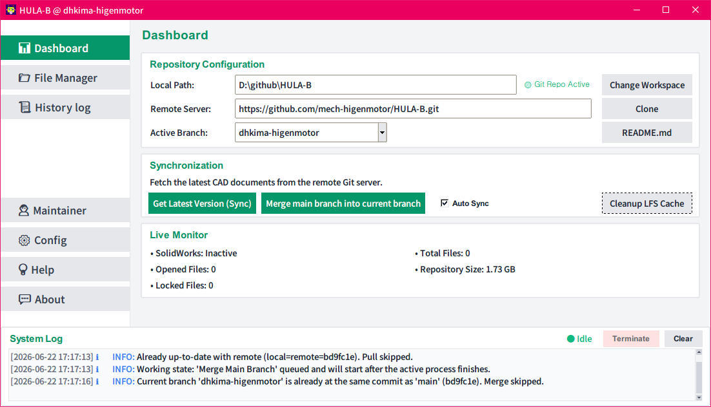
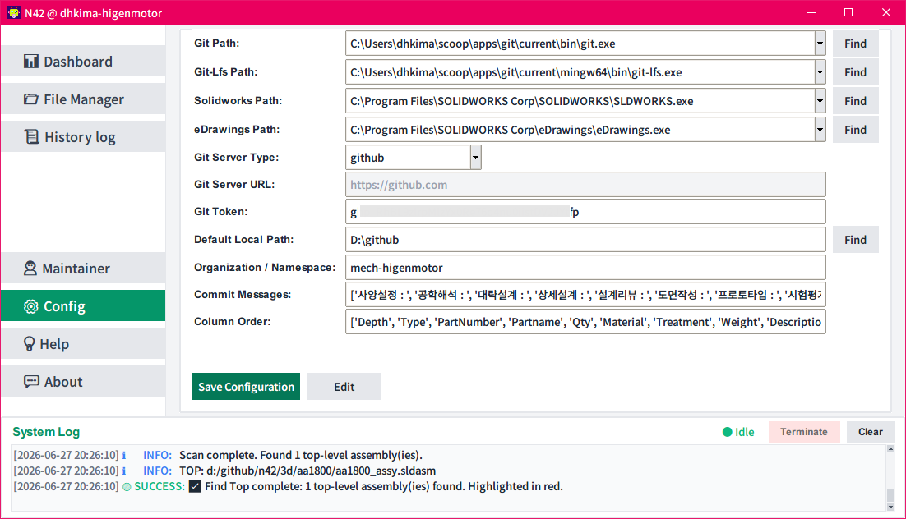
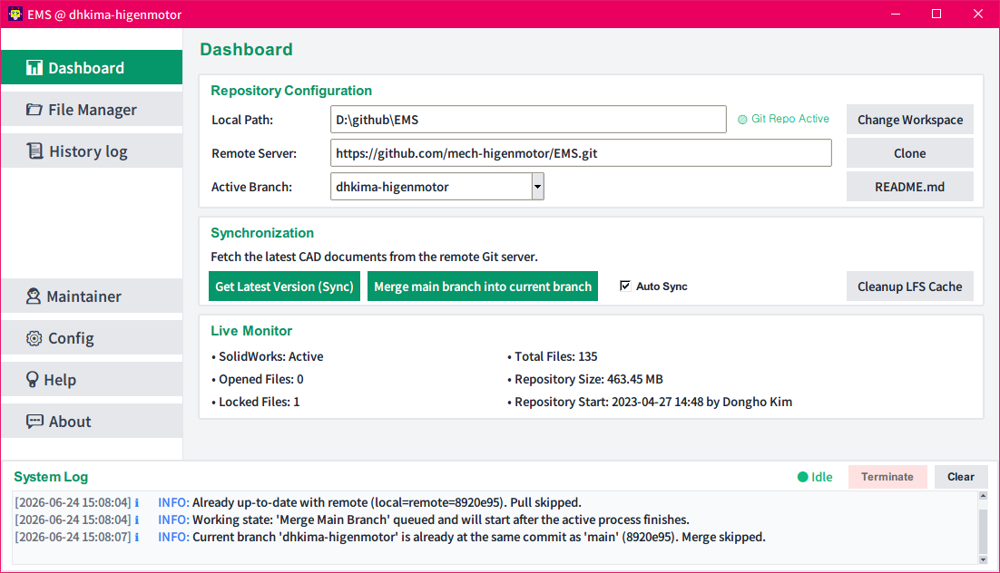
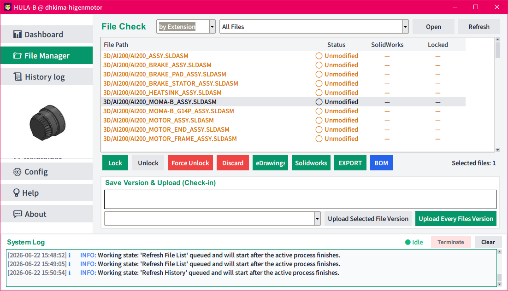
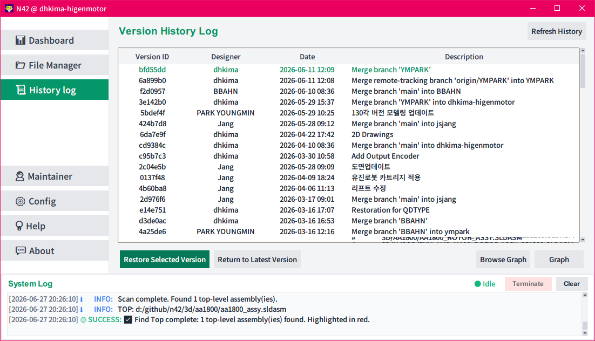
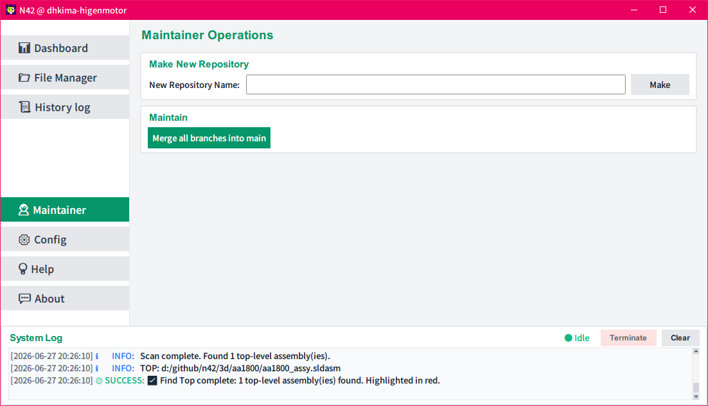

# GIT4SW: SolidWorks Git Version Control Client

[한국어 문서 (README_ko.md)](README_ko.md)

## Overview

When designing with SolidWorks, CAD binary files—drawings (`.slddrw`), parts (`.sldprt`), and assemblies (`.sldasm`)—cannot be text-merged in Git like source code. Without exclusive locking, concurrent edits across team members easily result in overwritten changes and broken assembly references.

**GIT4SW** is a **SolidWorks-dedicated Git & Git LFS desktop client** that combines standard Git branching workflows with **Git LFS File Locking** and **SolidWorks COM automation** to prevent CAD conflicts before they happen.



* Demo Video: [https://youtu.be/SGs7_w_s2pI](https://youtu.be/SGs7_w_s2pI)

---

## 1. Key Features

### CAD Collaboration & Safety
* **Auto Lock & Real-Time Monitor**: A background monitor tracks open documents via the SolidWorks COM API, automatically acquiring a Git LFS lock when a file (or assembly component) is opened and releasing it when closed. Toggleable via the Dashboard **Lock** checkbox (`auto_lock` in config).
* **Work Safety Guards**: Blocks uploads if target files are still open in SolidWorks or locked by another user. Warns before switching branches with unsaved changes. Preview/batch tools (**eDrawings**, **EXPORT**, **BOM**) open files in `ReadOnly` mode without interfering with locks.
* **Conflict Resolution & Auto Backup**: Detects merge/pull conflicts (including Git LFS pointer conflicts) and presents a multi-file **Ours / Theirs** resolution dialog. Before resolving, conflicted files are backed up to `.backup/` as `<filename>_OURS.<ext>` and `<filename>_THEIRS.<ext>` (toggleable via **Backup** / `auto_backup_conflicts`).

### Git & Multi-Server Workflow
* **GitHub & Gitea Support**: Supports both `github.com` (via PyGithub) and self-hosted Gitea servers such as Codeberg (via Gitea REST API v1). Configured via `git_server_type` and `gitea_url`.
* **Seamless Token Authentication**: Authenticates `git` and `git-lfs` operations dynamically via `git_token` and an inline credential helper (`git_helper.py`), preventing interactive Windows Credential Manager popups.
* **Branch & Maintainer Tools**: **Make my branch** creates and checks out a personal remote branch automatically. Maintainer mode provides **Make** (create private repo from `template/`, initialize LFS, and push) and **Merge all branches into main** (bulk merge with conflict dialog).
* **Auto Sync & Sequential Task Queue**: Optionally fetches and merges on startup or repository change (`auto_sync`). Long-running Git operations execute sequentially via a background task queue with a **Terminate** control for stuck processes.
* **Version History & Graph**: Browse commit history and double-click any commit to restore the workspace to that revision. Supports ASCII commit graph view and GitHub/Gitea network graph links.
* **LFS Cache Cleanup Wizard**: Safely purges unused `.git/lfs/objects/` files while preserving objects referenced by the current index and recent commits (`HEAD`, `HEAD~1`).

### SolidWorks Productivity Tools
* **EXPORT (Bulk Conversion)**: Batch-converts `.slddrw` (PDF, DXF), `.sldprt` (STEP AP214), and `.sldasm` (STEP_ASM AP214) across all or active configurations. Runs each file in an isolated worker with a 15-second COM heartbeat monitor and a 600-second silence watchdog to recover automatically if SolidWorks hangs.
* **BOM Extraction**: Traverses assembly structures recursively to export a hierarchical BOM Tree (`__BOM.xlsx`) and a flat Partlist (`__PL.xlsx`) under `2D/BOM/`, excluding suppressed and BOM-excluded components. Supports configuration selection for multi-configuration assemblies.
* **Find Top (Top-Level Assembly Scanner)**: Scans `.sldasm` dependency graphs using SolidWorks `GetDocumentDependencies2` (metadata-only, without opening models) and tags top-level assemblies with a red **`TOP`** badge.
* **Visual Diff**: Lets you pick a historical commit for a selected CAD file and open the current version (`_OURS`) alongside the historical version (`_THEIRS`) in SolidWorks for side-by-side comparison.
* **Color-Coded File List & Thumbnail Preview**: Displays parts in green (`#059669`), assemblies in orange (`#d97706`), and drawings in red (`#dc2626`), with sorting by name, extension, status, open state, or lock state, plus a 4:3 CAD thumbnail preview (click to copy to clipboard).
* **Multilingual Help & Config Editor**: Built-in Help viewer supports English (`help_en.md`), Korean (`help_ko.md`), and Japanese (`help_jp.md`). Click **Edit** in Config to open the active configuration file directly in Notepad.

---

## 2. Requirements

* **Operating System**: Windows 10 / 11 (x64)
* **CAD Software**: Dassault Systèmes **SolidWorks** and **eDrawings Viewer**
* **Runtime & CLI Tools**:
  * **Python**: `>= 3.12`
  * **Git**: `2.x` or higher
  * **Git LFS**: Extension for large binary tracking and file locking
  * **uv**: Python package and virtual environment manager

> [!TIP]
> You can install `git`, `git-lfs`, and `uv` quickly using **Scoop**:
> ```powershell
> scoop install git git-lfs uv
> ```

---

## 3. Installation & Startup

### Initial Setup
Clone the repository and create the `.venv` virtual environment with `uv`:

```powershell
uv sync
```

Copy `config.json.template` to `config.json` (if not already present) or configure it through the GUI after launch.

### Running GIT4SW
* **Standard launch**: Double-click **`GIT4SW.bat`** (runs `uv run main.py --config config.json`).
* **Gitea preset launch**: Double-click **`GIT4SW_gitea.bat`**.
* **Custom config / workspace via CLI**:
  ```powershell
  uv run main.py --config config_gitea.json
  uv run main.py --config config.json D:\path\to\workspace
  ```

---

## 4. User Manual

### 4.1 Configuration



Open the **Config** tab from the bottom of the left sidebar, fill in your local tool paths and credentials, and click **[Save Configuration]**. You can also click **[Edit]** to open the active JSON file in Notepad.

| Setting | Config Key | Description & Example |
| :--- | :--- | :--- |
| **Git Path** | `git_path` | Path to `git.exe` (e.g., `C:\Users\<user>\scoop\apps\git\current\bin\git.exe`) |
| **Git-Lfs Path** | `git-lfs_path` | Path to `git-lfs.exe` (e.g., `C:\Users\<user>\scoop\apps\git\current\mingw64\bin\git-lfs.exe`) |
| **Solidworks Path** | `solidworks_path` | Path to `SLDWORKS.exe` (e.g., `C:\Program Files\SOLIDWORKS Corp\SOLIDWORKS\SLDWORKS.exe`) |
| **eDrawings Path** | `edrawings_path` | Path to `eDrawings.exe` (e.g., `C:\Program Files\SOLIDWORKS Corp\eDrawings\eDrawings.exe`) |
| **Git Token** | `git_token` | Personal Access Token for GitHub or Gitea (`repo` / API write scopes) |
| **Git Server Type** | `git_server_type` | `github` or `gitea` |
| **Git Server URL** | `gitea_url` | Base URL for Gitea (e.g., `https://codeberg.org`); auto-set for `github` |
| **Default Local Path** | `default_local_path` | Default parent directory for cloning or creating new repositories (e.g., `D:\github`) |
| **Organization Name** | `organization_name` | Target GitHub/Gitea organization for new repositories |
| **Auto Sync** | `auto_sync` | Controlled via Dashboard **Sync** checkbox (`true` / `false`) |
| **Auto Backup Conflicts** | `auto_backup_conflicts` | Controlled via Dashboard **Backup** checkbox (`true` / `false`) |
| **Auto Lock** | `auto_lock` | Controlled via Dashboard **Lock** checkbox (`true` / `false`) |

### 4.2 Basic Workflow

1. **Register Workspace**
   * On the **Dashboard**, set **Local Path** to your Git repository folder. Valid repositories display **`(🟢 Active)`** along with the current branch.

2. **Create Personal Development Branch**
   * Click **[Make my branch]** on the Dashboard to create and switch to a branch named after your account and push its ref to `origin`.



3. **Edit Project README**
   * Click **[README.md]** next to the Active Branch section to open or create the workspace `README.md` in Notepad.



4. **Design in SolidWorks with Automatic Locking**
   * When **Lock** (`auto_lock`) is enabled, opening a part or assembly in SolidWorks triggers `git lfs lock` automatically so collaborators see the file as locked. Manual **Lock** / **Unlock** buttons remain available regardless of the toggle.

5. **Save and Upload Changes (Check-in)**
   * Open the **File Manager** tab, enter a commit message, and click **[Upload Selected File Version]** or **[Upload Every Files Version]** to commit, sync, push, and automatically release your locks on the uploaded CAD files.



6. **Inspect History & Restore**
   * Open **History log** and double-click any commit row to check out/restore the workspace to that commit.

7. **Bulk Export (PDF / DXF / STEP / STEP_ASM)**
   * Click **[EXPORT]**, choose target formats, configuration scope (`Every Configurations` or `Active Configuration Only`), optional filename `PREFIX`, and `OUTPUT_DIR` (default `2D`), then click **Start**.
   * Output files are saved under `<file_dir>/<OUTPUT_DIR>/<FORMAT>/` (e.g., `2D/PDF/`, `2D/DXF/`, `2D/STEP/`, `2D/STEP_ASM/`).

8. **Extract BOM & Partlist**
   * Select a single `.sldasm` file and click **[BOM]**. If multiple configurations exist, choose the target configuration in the prompt.
   * Generates `<assembly>__BOM.xlsx` (or `<assembly>__<config>__BOM.xlsx`) and `<assembly>__PL.xlsx` inside `2D/BOM/`.

9. **Cleanup Git LFS Cache**
   * On the Dashboard, click **[Cleanup LFS Cache]** to scan `.git/lfs/objects/` and remove orphaned LFS objects not used by the current index or the last two commits.

10. **Scan Top-Level Assemblies (Find Top)**
    * Click **[Find Top]** in the File Manager toolbar to scan `.sldasm` references via `GetDocumentDependencies2` and highlight top-level assemblies with a **`TOP`** tag.

### 4.3 Maintainer Mode



* **Make New Repository**: Enter a repository name and click **[Make]** to create a private repository on GitHub/Gitea, clone it to `Default Local Path`, initialize Git LFS, copy starter files from `template/` (`.gitattributes`, `.gitignore`, etc.), and push the initial `main` commit.
* **Merge All Branches into Main**: Fetches all remote branches, updates local refs, merges each branch into the default branch (`main`/`master`) with interactive **Ours / Theirs** conflict resolution when needed, and pushes the result to `origin`.

---

## 5. Troubleshooting

### 5.1 Git Authentication Issues
* Remote operations use `git_token` from your active config file via `git_helper.py`, bypassing interactive Windows Credential Manager prompts.
* If authentication fails, verify that `git_token` is valid and has repository/API write permissions, and confirm `git_server_type` and `gitea_url` match your remote URL.

### 5.2 Restoring Overwritten Local Changes After a Conflict
* When **Backup** (`auto_backup_conflicts`) is enabled, conflicted files are copied to `<workspace>/.backup/` as `<filename>_OURS.<ext>` and `<filename>_THEIRS.<ext>` before resolution.
* Copy the desired backup file back to its original path and rename it to recover your work.

### 5.3 SOLIDWORKS CAM Popups During EXPORT
If **SOLIDWORKS CAM** dialogs interrupt automated EXPORT runs:
1. Open SolidWorks and go to **Tools → Add-ins...**
2. Uncheck **SOLIDWORKS CAM** under both **Active Add-ins** and **Start Up**.
3. Click **OK** and close SolidWorks before running EXPORT again.

### 5.4 Sub-Components Opening as Read-Only in SolidWorks
If referenced parts or sub-assemblies open as **Read-Only** when launching an assembly via the **[Solidworks]** button:
1. Open SolidWorks and go to **Tools → Options... → System Options → External References**.
2. Uncheck **"Open referenced documents with read-only access"**.
3. Click **OK**, restart SolidWorks, and re-open the assembly.
