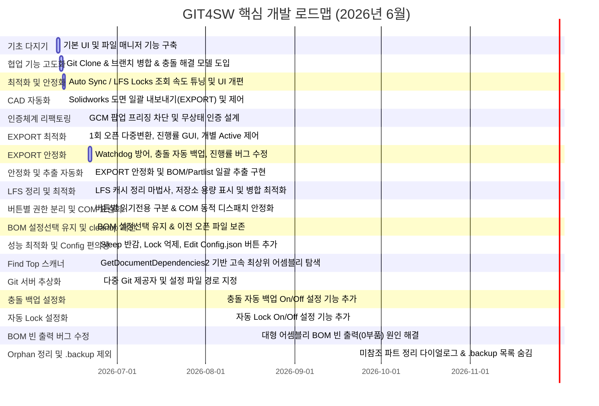

# GIT4SW 프로젝트 개발 역사 및 커밋 분석서 (Development History & Commit Analysis)

**GIT4SW**는 SolidWorks CAD 파일의 특성(바이너리, 대용량, 다중 사용자 동시 수정 충돌 위험)을 고려하여 Git LFS 및 원격 저장소(GitHub, Gitea/Codeberg 등) 환경에서 도면/모델 데이터의 협업을 안전하고 효율적으로 제어할 수 있도록 설계된 Python/Tkinter 기반의 GUI 형상 관리 보조 프로그램입니다.

본 문서는 프로젝트의 최초 커밋(2026-06-10)부터 최신 릴리즈까지 전체 Git 커밋 그래프와 개발 이력을 종합적으로 분석하여, 프로젝트가 어떠한 단계를 거쳐 현재의 수준 높은 도구로 성장했는지 체계적으로 기술합니다.

---

## 📅 전체 개발 타임라인 및 마일스톤 요약

---

## 🔍 단계별 상세 개발 내역

### 1단계: 프로젝트 기초 설계 및 파일 관리 기능 구축 (Milestone 1)
**기간:** 2026-06-10 ~ 2026-06-11
* **핵심 커밋 범위:** `b81f9a3 (V01)` ~ `b86c533`
* **주요 변경 사항 및 개발 동기:**
  - **프로젝트 출범 (`b81f9a3`)**: 최초 프로토타입(V01) 개발 및 원격 저장소 연동(Codeberg 링크 연동) 완료.
  - **기초 파일 매니저 구현 (`0aedaa3`, `65fef00`)**: 로컬 작업 폴더 내 CAD 파일들의 변경 이력 및 Git LFS 상태를 추적하기 위한 기초 뷰어 구축. Windows 환경에서의 대소문자 구분 없는 파일 잠금(case-insensitive LFS lock) 처리 지원.
  - **예외 처리 및 성능 보호 (`8cb64a4`, `4145869`)**: 백그라운드 동기화 과정에서 GUI가 멈추는(Freezing) 현상을 막기 위해 로그 쓰기 작업(`write_log`)의 Thread-safe 처리를 도입하고 `.gitignore`에 잡힌 임시 파일들은 파일 목록 탐색에서 자동 제외하도록 예외 필터 장착.
  - **SolidWorks 연동의 초석 (`65fef00`, `b86c533`)**: SolidWorks가 현재 켜져 있는지 여부를 감시하여 대시보드 내 카드 위젯에 `Active`/`Inactive` 상태를 실시간으로 출력하기 시작함.

---

### 2단계: Git Clone / Merge 고도화 및 conflict 제어 모델 도입 (Milestone 2)
**기간:** 2026-06-11 ~ 2026-06-12
* **핵심 커밋 범위:** `15eebda` ~ `3b0da00`
* **주요 변경 사항 및 개발 동기:**
  - **Repository 원격 설정 및 복제 (`60a4228` ~ `015fb05`)**: GUI 상에서 Remote Server 주소를 입력하여 바로 원격 저장소를 `Clone`할 수 있는 마법사 및 클론 경로 자동 보정 로직 개발. 로그 내 `github_token`이 노출되는 것을 사전에 가리는 마스킹 기능 이식.
  - **배포 & 병합 안정성 향상 (`31b9c85` ~ `aacae31`)**: 원격 서버의 다양한 브랜치가 서로 다이버징(Diverged) 되었을 때, 단순 `git pull`이 아닌 `git fetch` 후 `git merge` 처리를 하도록 병합 동작 개선. 병합이 끝난 뒤 원본 브랜치로 자동 롤백 및 푸시하도록 자동화 흐름 구축.
  - **다중 충돌 해결 도구 도입 (`924afc1`)**: 로컬 파일과 원격 서버의 파일이 겹쳐 충돌이 발생할 경우, 사용자가 이를 쉽게 제어할 수 있도록 **`MultiConflictResolutionDialog`**라는 다중 충돌 해결 대화창을 설계하여 분기 처리를 직관적으로 개선.
  - **커밋 템플릿 로더 (`b9d0581` ~ `3b0da00`)**: 작업 성격에 맞는 양질의 커밋 메시지 작성을 위해 외부 workspace 혹은 앱 폴더 내에 저장된 커밋 템플릿 양식을 동적으로 불러오는 컴보박스 위젯 연동.

---

### 3단계: 자동 동기화(Auto Sync) 및 캐시 최적화 (Milestone 3)
**기간:** 2026-06-12
* **핵심 커밋 범위:** `21e9953` ~ `f17c02f`
* **주요 변경 사항 및 개발 동기:**
  - **Auto Sync (자동 동기화) 구현 (`21e9953` ~ `3c354eb`)**: 매번 수동으로 동기화 버튼을 누르지 않아도 체크박스 상태에 따라 변경 사항이 발생할 경우 백그라운드에서 자동으로 main 브랜치와 병합하는 자동 동기화 기능 추가. 설정 파일(`config.json`)과의 영구 지속성 지원.
  - **OS 특화 한글 경로 디코딩 (`adc485a`, `6fc9ee9`)**: Windows Git 터미널 출력에서 논아스키(한글 등) 도면 파일명이 8진수 이스케이프 형태로 깨져 출력되는 이슈를 해결하기 위한 디코딩 핸들러 반영 및 하위 폴더 추적을 위한 `git status -u` 파싱 튜닝.
  - **백그라운드 병목 해결 (`1079c37` ~ `f17c02f`)**: 느린 성능의 PC 환경에서 백그라운드 모니터링 루프가 1초마다 LFS Locks를 조회하느라 과도한 CPU 연산을 소모하던 현상 포착. **"오직 열려 있는 파일 목록의 해시값에 변화가 있을 때만 LFS Locks 갱신 조회를 보낸다"**는 조건 처리를 이식하여 CPU 부하량을 획득 수준으로 제어.
  - **파일 정렬 및 탐색 확장 (`50e70b3` ~ `5c5a5d3`)**: 단순 이름 정렬 외에도 SolidWorks 파일 우선순위(부품 -> 도면) 정렬, 상태별 커스텀 정렬 및 알파벳 2차 정렬 기준 지정으로 수많은 파일 목록을 신속히 파악하도록 개선.

---

### 4단계: SolidWorks 도면 일괄 EXPORT 자동화 (Milestone 4)
**기간:** 2026-06-13
* **핵심 커밋 범위:** `cea6f57` ~ `b7c95eb`
* **주요 변경 사항 및 개발 동기:**
  - **도면 내보내기(EXPORT) 최초 탑재 (`a2f78ed`)**: SolidWorks API와 직접 OLE 연동하여 대량의 slddrw, sldprt, sldasm 도면/모델 파일을 버튼 하나로 PDF(흑백/펜 테이블 옵션), DXF, STEP(AP214 컬러 지정) 포맷으로 일괄 변환 저장해 주는 자동 변환 매크로 기반 모듈 개발.
  - **저장 재촉 팝업 억제 (`883ebb8`, `8281ce6`)**: 대량 변환 도중 파일에 저장되지 않은 임시 값 등이 있을 때 SolidWorks가 띄우는 "저장하시겠습니까?" 팝업창으로 인해 프로세스가 멈추는 문제를 방지하고자, 문서 닫기 API 호출 방식을 최적화하고 경고 및 안내 팝업을 가로채 차단 처리.

---

### 5단계: Git 인증 무상태(Stateless) 우회 설계 (Milestone 5)
**기간:** 2026-06-20
* **핵심 커밋 범위:** `34d3ac2` ~ `38e6e61`
* **주요 변경 사항 및 개발 동기:**
  - **Windows GCM 팝업 프리징 분석**: Git push/pull 시 윈도우 시스템 자격증명관리자(GCM)가 계정 입력을 촉구하며 백그라운드에 감춰진 대화창을 띄워 프로그램 전체가 락이 걸리는(Deadlock) 심각한 고질적 문제 인지.
  - **로컬 헬퍼 주입 설계 (`1e4d418` ~ `b4c951a`)**: 시스템 GCM 체인을 우회하고 메모리의 `GIT4SW_TOKEN`을 자격증명 인터페이스 규격(stdin)으로 반환하는 독립형 자격증명 도우미 스크립트([git_helper.py](file:///d:/codeberg/GIT4SW/git_helper.py)) 개발 및 로컬 바인딩.
  - **무상태(Stateless) 인라인 기법으로 리팩토링 (`6c01ee0`, `38e6e61`)**: `.git/config` 파일에 헬퍼 경로를 계속해서 적고 지우는 작업은 파일 손상 및 I/O 낭비를 유발하므로, Git 명령어 호출 시점에만 인라인 파라미터(`-c credential.helper= -c credential.helper="..."`) 형태로 자격증명 체인을 강제 빈 슬롯으로 밀어 넣은 뒤 임시 헬퍼를 체인하여 동적으로 인증하도록 변경. 이로써 어떠한 잔여물 없이 깔끔하고 빠른 원격 처리가 완료됨.

---

### 6단계: EXPORT 흐름 고도화 및 세부 파일 선택(Active On/Off) 설계 (Milestone 6)
**기간:** 2026-06-20
* **핵심 커밋 범위:** `08d6f17`
* **주요 변경 사항 및 개발 동기:**
  - **도면 파일 1회 오픈 최적화**: 기존에는 PDF와 DXF 변환 시 각각 slddrw 파일을 처음부터 열고 닫는 과정을 반복했으나, **파일 1회 열기 ➔ PDF 저장 ➔ DXF 저장 ➔ 파일 닫기**의 원스톱 시퀀스로 리팩토링하여 디스크 및 CAD 엔진 자원 낭비를 절반으로 감소시킴.
  - **변환 실행 흐름 고정**: 포맷이 꼬이지 않도록 변환 및 진행 순서를 항상 `PDF -> DXF -> STEP -> STEP_ASM` 순으로 강제 정렬.
  - **비동기 프로그레스바 모달 팝업**: 변환 도중 메인 UI가 전혀 먹통이 되지 않도록 파이프라인 감시 백그라운드 데몬 스레드를 돌려 실시간으로 변환 진행률(`x/y번째 파일 변환 중`)을 갱신하는 모달 창 구축. 테마인 에메랄드 그린 컬러바(`Custom.Horizontal.TProgressbar`) 적용.
  - **INFO 창 내 Active On/Off 기능 구현**:
    - "Detailed Files List" 텍스트 라벨을 삭제하여 콤팩트한 화면 영역 확보.
    - 테이블 내에 각 파일이 변환에 참가할지 여부를 선택하는 **Active(On/Off)** 열 신설. (On: 파란색, Off: 회색 지정)
    - `Ctrl+클릭`, `Shift+클릭` 및 `Ctrl+A`를 연동하여 여러 행을 마우스와 단축키로 쉽게 전체 지정 가능.
    - `On`/`Off` 일괄 지정 버튼을 통해 변환 활성화 파일을 손쉽게 거르고, Close를 누르면 이 동적 필터 리스트가 메모리에 유지되어 최종 EXPORT 시작 시점에 타겟 파일 목록에 엄격히 대입되도록 설계.

---

### 7단계: EXPORT Watchdog 방어 및 충돌 파일 자동 백업 (Milestone 7 - 2026-06-21)
* **EXPORT 개별 파일 변환 Watchdog 타이머**:
  - 개별 도면 파일 변환 시 발생할 수 있는 SolidWorks 엔진의 무한 대기 및 교착 상태(Deadlock)를 방지하기 위해 **3분(180초) Watchdog 타이머**를 구현하였습니다.
  - 각 파일의 변환 처리를 `--single` 옵션의 재귀 서브프로세스로 분리하여 가동하며, 제한 시간 초과 시 서브프로세스 강제 종료 및 기존 SolidWorks PID `taskkill` 처리 후 새 인스턴스를 재생성하여 다음 파일 변환으로 자동 복원 및 계속 진행하도록 설계했습니다.
* **원격 동기화 시 충돌 파일 자동 백업 (.backup/ 폴더)**:
  - 병합(Merge) 및 풀(Pull) 도중 발생한 단일/다중 충돌 상황에서 사용자에게 충돌 해결을 묻기 직전, 수정 전 로컬 작업 파일 복사본을 자동으로 안전한 임시 디렉토리에 보존하는 백업 메커니즘을 구현하였습니다.
  - 워크스페이스 내에 `.backup/` 폴더를 생성하고, 충돌 파일의 로컬 버전을 `파일명_YYYYMMDD_HHMMSS.확장자` 형태로 복사하여 보존합니다.
  - 백업된 파일이 불필요하게 Git 트래킹 목록에 포함되지 않도록 `template/_gitignore` 설정에 `.backup/` 패턴을 예외 처리로 반영하였습니다.

---

### 8단계: EXPORT 안정화 — 코드 정리, 진행률 카운트 수정, 조기 중단 버그 수정 (Milestone 8 - 2026-06-22)
* **BOM 기능 및 SOLIDWORKS CAM 코드 완전 제거**:
  - EXPORT 다이얼로그에 일시적으로 탑재되었던 **BOM 자동 추출 기능**(BOM Export On/Off 라디오버튼, CSV 생성 로직 등)을 사용 편의성 및 안정성 이유로 완전히 삭제하였습니다.
  - 기존에 EXPORT 시작 전 SOLIDWORKS CAM 애드인(`camworksu.dll`)을 강제 비활성화하는 로직이 포함되어 있었으나, 불필요한 간섭을 유발할 수 있어 관련 코드(`UnloadAddIn`, `LoadAddIn`, CAM 경고 팝업 억제 코드)를 `sw_export_runner.py`, `ui_tk.py`, `sw_monitor.py`에서 모두 제거하였습니다.
* **EXPORT 팝업 창 세로 사이즈 확장**:
  - EXPORT 다이얼로그의 세로 사이즈(`minsize`, `geometry`)를 조정하여, 버튼이 잘리지 않고 완전하게 표시되도록 개선하였습니다.
* **EXPORT 진행률 Completed 카운트 버그 수정** (핵심):
  - **문제**: 기존에는 EXPORT 진행 완료 개수가 `.sldasm`/`.sldprt` 파일 내부의 설정(Configuration) 수만큼 생성되는 STEP 파일 개수 기준으로 카운트되어, 실제 처리 대상 CAD 파일 개수와 불일치하는 버그가 있었습니다.
  - **수정**: `sw_export_runner.py`에 `processed_count` 변수를 별도로 도입하여, 파일 존재 여부 확인 후 반드시 **CAD 파일 1개당 정확히 1 증가**하도록 수정하였습니다. `[PROGRESS]` 출력도 이 변수를 기준으로 변경되었습니다.
* **EXPORT 루프 조기 중단 버그 수정** (핵심):
  - **문제**: Watchdog 타임아웃이 발생한 후 SolidWorks 재시작도 실패하면, `break`로 인해 루프 전체가 종료되어 나머지 파일들이 처리되지 않는 현상이 있었습니다.
  - **수정**: `break`를 `continue`로 변경하였습니다. 자식 서브프로세스는 SolidWorks에 독립적으로 연결하므로 부모의 `swApp` 핸들이 없어도 나머지 파일들의 변환을 계속 시도할 수 있습니다.
* **EXPORT 안정성 추가 개선 및 COM 교착 방지 / 한글 인코딩 오류 차단** (핵심):
  - **COM 참조 카운트 정리 및 GC 강제 실행**: 솔리드웍스 문서 닫기(`CloseDoc`) 호출 직전, Python 메모리상에 상주해있던 `ModelDoc2` 객체 및 문서 목록 배열 등의 COM 참조 변수들을 모두 `None`으로 소거하고 `gc.collect()` 및 `CoCollectFreeUnusedLibraries()`를 강제 호출하여 reference lock을 해제함으로써, SolidWorks 내부적으로 교착 상태(Deadlock)나 파일 닫기 실패 현상을 완벽하게 방지하도록 아키텍처를 개선했습니다.
  - **`CloseDoc` 호출 인자 값 정상화**: 기존에 absolute file path(절대 경로)로 넘겨 오동작하던 `CloseDoc` API의 인자를 `model.GetTitle()`에서 얻은 문서 제목(Title/Name)으로 보정하여 문서가 실제로 닫히도록 수정했습니다.
  - **한글 인코딩 및 스트림 차단 오류 수정**: 윈도우 OS 환경에서 도면/설정명에 한글(예: `기본`)이 포함된 경우, 자식 프로세스가 출력하는 UTF-8 스트림과 부모 및 UI 간의 인코딩 불일치로 인해 발생하던 `UnicodeDecodeError` 및 `UnicodeEncodeError` 현상을 차단하기 위해 `sys.stdout`/`sys.stderr` 스트림 인코딩을 동적으로 `utf-8`(`errors="replace"`)로 재설정하고, `subprocess.Popen` 호출에 `PYTHONIOENCODING="utf-8"` 환경 변수 주입 및 `errors="replace"`를 추가하여 UI 프로그레스 감시 스레드가 깨지지 않도록 해결했습니다.

---

### 9단계: 솔리드웍스 BOM 및 Partlist 일괄 추출 자동화 (Milestone 9 - 2026-06-22)
* **BOM / Partlist 추출 기능 전용 엔진 탑재**:
  - File Manager 탭의 파일 목록 툴바에 전용 **[BOM]** 버튼을 배치하고, 선택된 단일 어셈블리(`.sldasm`) 파일에 대한 BOM Tree 및 Partlist를 자동으로 추출해 주는 백그라운드 엔진(`sw_bom_runner.py`)을 설계하였습니다.
  - 최하위 레벨 부품/어셈블리까지 깊이 제한 없이 완전하게 추적(Traverse)하여 BOM 계통 트리와 전체 수량이 취합된 납작한 파트리스트(Partlist)를 일괄 출력합니다.
  - SolidWorks 내 억제(Suppressed) 상태인 부품 및 어셈블리 속성에서 'BOM에서 제외(BOM Exclude)' 설정된 부품들을 정확하게 판별하여 추출에서 완전 제외합니다.
* **설정(Configuration) 팝업 분리 및 COM 아파트먼트 교착 방지**:
  - 2개 이상의 설정(Configuration)이 포함된 어셈블리 파일의 경우, BOM Tree 작성 전에 사용자에게 원하는 설정을 선택하도록 팝업창을 띄웁니다.
  - GUI 메인 스레드 상에서 `pythoncom` 호출 시 발생하는 COM 아파트먼트 모델(STA/MTA) 충돌 및 silent failure를 해결하기 위해, 설정 목록 조회부를 별도의 클린 독립 Python 서브프로세스로 분리 가동하도록 설계하였습니다. 이를 통해 한글 설정명(예: `기본`) 조회 및 팝업 표출이 교착이나 프리징 없이 안정적으로 처리됩니다.
* **BOM 저장 포맷 및 트리 인덴테이션 지원**:
  - 지정된 컬럼 순서(`Depth`, `Type`, `PartNumber`, `Partname`, `Qty`, `Material`, `Treatment`, `Weight`, `Description`, `File Name`, `Configuration`, `File Path`) 규칙을 엄격히 준수하여 Excel 시트(`__BOM.xlsx`, `__PL.xlsx`)를 작성하고 `2D/BOM/` 경로에 자동 저장합니다.
  - `Partname`이 비어 있는(Null) 경우 파일명(확장자 제외)으로 대체하며, `__BOM.xlsx` 트리 구조 가독성을 극대화하기 위해 `Partname` 문자열 앞단에 `{Depth - 1}` 크기만큼의 공백 스페이스를 자동으로 삽입해 줍니다.
  - BOM 추출이 완료되면, SolidWorks에서 함께 열렸던 하위 참조 파트 및 서브 어셈블리 문서들을 메모리 참조 소거(GC 강제 호출)와 함께 리턴하여 완벽하게 연쇄 폐쇄(`CloseDoc`) 정리하도록 자동화 시퀀스를 구축했습니다.

---

### 10단계: LFS 캐시 정리 마법사 탑재, 대시보드 저장소 용량 표시 및 동기화 최적화 (Milestone 10 - 2026-06-22)
* **Git LFS 캐시 정리 마법사 (`LfsCleanupWizardDialog`) 도입**:
  - 로컬 `.git/lfs/objects/` 폴더 내의 미사용 대용량 바이너리 파일을 선별하여 일괄 정리해 주는 디스크 공간 정리 마법사를 개발하여 탑재했습니다.
  - 현재 인덱스(작업 트리) 및 최근 2개 커밋(`HEAD`, `HEAD~1`)의 히스토리에서 참조하는 LFS 파일들(Kept Files)만 남기고, 과거의 미사용 LFS 캐시 파일들을 선별하여 일괄 안전하게 물리적으로 삭제하고 빈 디렉토리를 정리합니다.
  - 대시보드의 동기화(Synchronization) 패널에 **[Cleanup LFS Cache]** 버튼을 통해 쉽게 실행할 수 있습니다.
* **대시보드 실시간 저장소 용량(Repository Size) 계산 및 표시**:
  - 대시보드의 실시간 모니터링 카드에 **• Repository Size** 상태 필드를 신설했습니다.
  - 백그라운드 모니터 스레드가 로컬 작업 저장소의 총 물리적 파일 크기를 주기적으로 자동 합산하여, 바이트(B), 킬로바이트(KB), 메가바이트(MB), 기가바이트(GB) 단위로 가독성 있게 동적 변환하여 화면에 출력합니다.
* **버전 비교 기반의 동기화 및 브랜치 병합 최적화**:
  - 동기화(Sync/Pull) 및 머지(Merge) 명령 수행 전 원격 저장소(`origin`)를 먼저 fetch하여 최신 변경점을 확인합니다.
  - 현재 로컬 브랜치의 최신 커밋이 대상 브랜치(예: `origin/main` 또는 원격 개발 브랜치)의 최신 커밋 해시와 완전히 동일하거나(Already identical), 혹은 이미 병합된 조상 커밋(Ancestor)일 경우, 무거운 Git merge 연산을 수행하지 않고 즉시 병합 작업을 스킵(Skip)하도록 최적화하여 동기화 작업 속도를 극대화했습니다.

---

### 11단계: COM 동적 디스패치 표준화 및 버튼별 파일 잠금/권한 처리의 엄격한 분리 (Milestone 11 - 2026-06-22)
* **COM 동적 디스패치 (`win32com.client.dynamic.Dispatch`) 전면 표준화**:
  - 특정 환경의 `%TEMP%\gen_py` 캐시 빌드로 인해 발생하는 `TypeError: int() argument must be a string, a bytes-like object or a real number, not 'VARIANT'` 크래시 오류를 원천 차단하기 위해, 애플리케이션 및 하위 문서 객체 바인딩을 지연 바인딩(late-binding) 기반의 동적 디스패치로 전면 수정하였습니다.
* **버튼별 읽기 전용 여부 분리 및 동적 LFS Lock 처리**:
  - **SolidWorks 버튼**: 사용자가 파일 잠금(Lock)을 소유하고 있거나 lock 명령에 성공한 파일만 쓰기 권한(디스크 읽기전용 해제 및 `swOpenDocOptions_Silent` = 1)을 주어 활성화하고, 타인 소유 또는 잠금 실패 시에는 안전하게 읽기 전용 모드(`swOpenDocOptions_Silent | swOpenDocOptions_ReadOnly` = 1 | 2)로 오픈하여 충돌 실수를 사전에 차단합니다.
  - **BOM, EXPORT, eDrawings 버튼**: 도면/모델을 단순 참고하거나 외부로 출력만 하는 버튼들이므로, 로컬 파일 잠금 획득이나 권한 속성 수정을 수행하지 않습니다. 특히 BOM 추출 스크립트(`sw_bom_runner.py`)는 대상 어셈블리를 조용히 읽기 전용 모드로 로드하여 다른 엔지니어와의 파일 락 경합을 방지하도록 격리하였습니다.

---

### 12단계: BOM 추출 시 설정 선택 후 파일 닫기 억제 및 이전 오픈 파일 목록 보존 처리 (Milestone 12 - 2026-06-23)
* **설정 선택 완료 후 파일 닫기 흐름 제어**:
  - 기존에는 BOM 추출 버튼 클릭 시 설정(Configuration) 선택 팝업을 띄우기 위해 어셈블리 파일을 임시로 silent 오픈하고, 사용자가 설정을 선택하면 해당 임시 파일을 즉시 닫은 후 BOM 추출 시 다시 여는 구조였습니다.
  - 이 과정에서 이미 열렸던 대용량 어셈블리가 유실/닫히면서 하위 참조 컴포넌트들의 SolidWorks 로딩 오버헤드가 반복되었습니다.
  - 이를 보완하여 설정 목록을 확인하기 위해 열어둔 파일을 **닫지 않고 그대로 유지**하며, 이어진 실제 BOM 추출 프로세스가 이 열린 환경을 재사용하여 속도와 파일 상태의 일관성을 높이도록 개선했습니다.
* **BOM 실행 이전 오픈 파일 목록의 동적 추적 및 Cleanup 정밀화**:
  - 설정 조회 시 파일을 닫지 않게 됨에 따라, BOM 러너 실행 시점에는 대상 도면 파일들이 SolidWorks 상에 이미 open되어 있는 상태가 됩니다.
  - 이로 인해 BOM 러너가 종료될 때, 원래 사용자가 열어둔 파일(Pre-existing files)과 BOM 동작을 위해 시스템이 연 파일(BOM-specific files)을 구별할 수 없어 전체가 닫히거나 닫히지 않는 누수 위험이 있었습니다.
  - 이를 해결하기 위해 BOM 버튼을 클릭한 최초 순간(설정 조회 이전)에 SolidWorks에서 열려 있던 파일들의 절대 경로 목록을 `self.sw_open_before_bom`에 실시간으로 수집하고, 이를 BOM 러너(`sw_bom_runner.py`)에 `--open-before` 매개변수로 명시적 주입하도록 구성했습니다.
  - BOM 러너는 이 목록에 기재된 파일들만 "원래 열려 있던 파일"로 판정하여 유지하고, 그 외 BOM 진행 과정(설정 조회 + BOM 추출) 중 동적으로 로드된 임시/참조 파일들만 선별하여 안전하게 일괄 CloseDoc/QuitDoc 처리합니다.
* **일괄 병합(Merge all branches into main) 최적화**:
  - 관리자(Maintainer) 모드에서 여러 브랜치를 `main` 브랜치로 순차 병합할 때, 대상 개발 브랜치가 이미 `main` 브랜치에 병합되어 있거나 커밋이 완전히 동일한 경우(`is_ancestor` 판정) 불필요한 merge 작업을 생략(Skip)하여 일괄 병합 전체 소요 시간을 획기적으로 줄였습니다.
* **백그라운드 작업 대기열 경고(Refresh) 로그 출력 최적화**:
  - 백그라운드 작업 수행 중 화면 갱신 기능(Refresh History, Refresh File List 등)이 대기열에 쌓일 때마다 GUI 로그 패널에 다량의 대기 안내 로그가 중복 출력되던 현상을 수정하여, 사용자 편의를 도모하고 로그 패널의 시인성을 개선했습니다.
* **버전 탐색 후 직전 활성 브랜치 자동 복구**:
  - 버전 이력 탐색("History log" 모드) 중 과거 커밋을 더블클릭하여 Detached HEAD 상태로 진입한 후, **[Return to Latest Version]** 버튼을 통해 최신 버전으로 복귀할 때, 기존의 단순 main 브랜치 강제 전환이 아닌 직전 활성 브랜치(`self.last_active_branch`) 정보를 기억하여 해당 브랜치로 즉시 전환·복구하도록 복귀 알고리즘을 고도화했습니다. (해당 브랜치가 로컬에 존재하지 않는 예외 상황에서는 안전하게 main 브랜치로 자동 폴백(Fallback) 처리됩니다.)
* **GitHub Network 기반 대화형 Git 커밋 그래프 브라우징 (Browse Graph)**:
  - 버전 이력 화면("History log")에 **[Browse Graph]** 버튼을 신설하고, 원격 저장소 URL을 자동으로 분석하여 GitHub이 공식 제공하는 대화형 커밋 Network 그래프 페이지(`https://github.com/{owner}/{repo}/network`)를 기본 웹 브라우저로 직접 띄워 주도록 연동했습니다.
  - 이를 통해 외부 라이브러리 의존성과 로컬 렌더링 부하를 완전히 없애고, 브라우저 상에서 완벽한 스크롤, 줌, 브랜치 병합 추적 기능을 보장합니다.
* **개별 파일 커밋 이력 조회 및 Diff 팝업 추가**:
  - File Manager 모드의 액션 패널 내 BOM 버튼 우측에 **[Diff]** 버튼을 추가했습니다. 해당 버튼은 파트(`.sldprt`) 또는 도면(`.slddrw`) 파일 하나만 선택했을 때 활성화되며, 비활성화 상태에서는 텍스트가 흐리게 표시되어 시인성을 극대화합니다.
  - Diff 버튼 클릭 시 메인 GUI 스레드가 얼어붙지 않도록 별도의 백그라운드 스레드에서 파일의 Git 커밋 이력(`git log`)을 조회하여 대화상자의 테이블(Treeview)에 표시합니다.
  - 대화상자에는 스크롤바와 함께 선택한 특정 커밋과 현재 버전을 대조할 수 있는 Diff 실행 및 종료(Exit) 버튼이 포함되어 있으며, 종료 시 작업 중인 스레드를 안전하게 종료(Cancel Event)하도록 보장합니다.
  - **SOLIDWORKS 연동 Visual Diff 구현**:
    - 선택된 커밋 버전의 파일과 현재 작업본(Local)을 각각 `.backup/` 폴더 내에 `{파일명}_THEIRS` 및 `{파일명}_OURS` 이름으로 자동 추출합니다. (이때 Git LFS로 추적 중인 대용량 CAD 파일의 경우 포인터 텍스트가 아닌 실제 원본 바이너리를 획득할 수 있도록 `git lfs smudge` 파이프 연산을 자동 지원합니다.)
    - 두 파일을 SolidWorks에서 `OpenDoc6`로 불러들입니다. 실행 중인 SolidWorks가 없다면 `sldworks.exe`를 자동 실행하고 최대 60초간 ROT 폴링으로 연결을 시도합니다.
    - 로드 완료 후 사용자에게 SolidWorks 메뉴를 통한 수동 비교를 안내하는 알림 팝업을 표시합니다. 파트(`.sldprt`)의 경우 "Use Tools > Compare > Geometry menu to compare.", 도면(`.slddrw`)의 경우 "Use Tools > Compare > Draw Compare menu to compare." 메시지를 노출합니다.
    - 두 파일은 SolidWorks에 열린 상태로 유지되어 사용자가 직접 비교 도구를 실행하고 검사할 수 있으며, 이후 문서를 닫거나 SolidWorks를 강제 종료하는 등의 추가 동작은 수행하지 않습니다.

---

### 13단계: 성능 최적화 — 인위적 대기 시간 50% 단축 및 EXPORT/BOM 중 자동 Lock 억제 (Milestone 13 - 2026-06-24)
* **EXPORT/BOM 중 자동 Lock 모니터 억제**:
  - EXPORT 및 BOM 서브프로세스가 SolidWorks에 파일을 열 때(ReadOnly 모드), 백그라운드 자동 Lock 모니터가 이를 감지하여 불필요한 `git lfs lock`을 시도하는 문제를 해결하였습니다.
  - `ui_tk.py`에 `suppress_auto_lock` 플래그를 도입하여, EXPORT/BOM 실행 중에는 모니터의 Lock 시도를 완전히 차단합니다. (BOM/EXPORT runner는 ReadOnly로 파일을 열므로 Lock 획득이 불필요합니다.)
* **모든 `time.sleep()` 인위적 대기 시간 50% 축소**:
  - **EXPORT 안정화 대기**: `SaveAs3` 후 2초 → 1초, `ShowConfiguration2` 후 2초 → 1초, Assembly 처리 후 3초 → 1.5초
  - **문서 닫기 클린업 대기**: 0.3초 → 0.15초, 0.2초 → 0.1초
  - **ROT 폴링 간격**: 1초 → 0.5초
  - **백그라운드 모니터 폴링 주기**: SW 실행 중 6초 → 3초, 미실행 12초 → 6초
  - **Lock/Unlock 후 refresh 대기**: 1.5초 → 0.75초
  - 그 외 모든 `time.sleep()` 호출을 공통적으로 절반으로 축소하여 EXPORT 일괄 처리 시간을 약 50% 단축하였습니다.
* **Config 뷰에 "Edit Config.json" 버튼 추가**:
  - "Save Configuration" 버튼 우측에 "Edit Config.json" 버튼을 추가하였습니다.
  - "Find" 버튼과 동일한 기본 TButton 스타일을 사용합니다.
  - 클릭 시 `config.json` 파일을 윈도우 기본 메모장(`notepad.exe`)으로 직접 열어 빠른 설정 편집이 가능합니다.

---

### 14단계: Find Top (최상위 어셈블리 스캐너) — `GetDocumentDependencies2` 기반 고속 의존성 분석 (Milestone 14 - 2026-06-24)
* **"Find Top" 버튼 추가**:
  - File Manager 툴바의 **[Refresh]** 버튼 우측에 Primary.TButton 스타일(녹색 `#059669` 배경, 흰색 텍스트)의 **[Find Top]** 버튼을 추가하였습니다.
  - 워크스페이스 내 모든 `.sldasm` 파일의 의존성 그래프를 분석하여, 다른 어셈블리에서 참조되지 않는 최상위 어셈블리(Top-Level Assembly)를 식별합니다.
  - 식별된 최상위 어셈블리는 CustomFileTable의 `top_asm` 태그로 빨간색 굵게(`#dc2626`) 강조 표시됩니다.
* **SolidWorks 파일 의존성 분석 엔진 전면 재작성 (`sw_top_finder.py`)**:
  - **문제**: 기존에는 `OpenDoc6`으로 어셈블리 파일을 직접 열고, `ConfigurationManager` → `GetRootComponent3` → `GetChildren` → `GetPathName`을 통해 자식 참조 경로를 추출한 후 `CloseDoc`/`QuitDoc`으로 닫는 과정을 거쳤습니다. 파일 하나당 약 1~3초의 열기/안정화/닫기 오버헤드가 발생하여 수백 개 어셈블리 스캔 시 심각한 성능 저하를 유발했습니다.
  - **해결**: `SldWorks.GetDocumentDependencies2` COM API로 전환하였습니다. 이 API는 파일을 SolidWorks에 열지 않고 파일 헤더의 의존성 메타데이터 블록만 읽어 참조 관계를 배열로 반환합니다.
  - 성능상의 이점: 파일 열기/닫기 오버헤드 제거, SolidWorks COM 안정화 대기 시간(`time.sleep`) 불필요, GUI 고정(Freeze) 현상 원천 차단.
* **다중 API Fallback 체계 구축**:
  - 1순위: `GetDocumentDependencies2` (정확 모드, `fastParsing=False`)
  - 2순위: `GetDocumentDependencies2` (고속 모드, `fastParsing=True`)
  - 3순위: `GetDocumentDependencies` (4인자)
  - 4순위: `GetDocumentDependencies` (1인자)
  - `getattr()`를 사용하여 메서드 존재 여부를 먼저 확인하므로, 메서드가 아예 없는 환경에서도 `AttributeError` 없이 다음 variant로 안전하게 폴백합니다.
* **자기참조(self-reference) 제외 및 경로 검증**:
  - 반환 배열에서 부모 파일 자신을 결과에서 제외합니다.
  - `os.path.exists()`로 유효한 파일 경로만 수집하여 잘못된 문자열이 포함되는 것을 방지합니다.
* **Cleanup 간소화**: `GetDocumentDependencies2`는 파일을 열지 않으므로 `finally` 블록의 `CloseDoc`/`QuitDoc` 문서 정리 코드를 완전히 제거하였습니다.

---

### 15단계: 다중 Git 서버 제공자 추상화 및 설정 파일 경로 지정 (Milestone 15 - 2026-06-25)
* **Git 제공자 추상화 계층 (`git_provider.py`)**:
  - `GitProvider` 추상 베이스 클래스와 `GitHubProvider`, `GiteaProvider` 구현체를 신설하여 Git 서버별 원격 API 호출을 인터페이스로 분리했습니다.
  - GitHub는 PyGithub을 통해 `github.com` API를 호출하고, Gitea는 자체 REST API v1 엔드포인트를 직접 호출합니다.
  - `parse_remote_url()`, `detect_provider()`, `create_provider()` 팩토리 함수 제공.
* **설정 파일 구조 변경**:
  - `config.json`에 `git_server_type` (`github`/`gitea`) 필드 추가: 어떤 Git 서버 제공자를 사용할지 명시적으로 선택.
  - `github_token`을 `git_token`으로 통일 (하위 호환성 유지: `github_token`도 대체 필드로 읽음).
  - `gitea_url` 필드 추가: Gitea 서버의 기본 URL 지정 (`git_server_type`이 `github`일 때는 빈 문자열로 저장).
* **설정 파일 경로 CLI 지정 (`--config`)**:
  - `main.py`에 `--config` 인자를 추가하여 프로그램 시작 시 사용할 설정 파일 경로를 지정 가능 (예: `--config config_codeberg.json`).
  - `GIT4SW.bat`는 기본값 `config.json`을 전달.
  - `git_service.set_config_file_path()`를 통해 전역 함수에서도 설정 파일 경로를 사용.
* **`git_service.py` 리팩토링**:
  - `GitService`가 `GitProvider`를 통해 원격 API를 호출하도록 개선 (git_server_type에 따라 GitHubProvider 또는 GiteaProvider 사용).
  - `run_git_subprocess()`에 `GIT4SW_GIT_HOSTS` 환경변수 전달을 위한 `git_helper.py` 연동 강화.
* **`git_helper.py` 유연성 향상**:
  - `GIT4SW_GIT_HOSTS` 환경변수로 허용 호스트 목록을 동적으로 설정. 기본값은 `github.com`.
* **Config UI 개선 (`ui_tk.py`)**:
  - "Edit Config.json" 버튼 → "Edit"으로 단축; "Configuration Manager" 제목 제거.
  - "Git Server Type" 콤보 박스가 "Git Server URL" 입력 필드를 토글 (github→비활성화+`https://github.com` 자동입력, gitea→활성화).
  - "Git Server URL" 행을 "Git Token" 위로 재배치.
  - "Default Local Path"에 Find 버튼 추가하여 디렉토리 선택기 제공.
  - 행 간격 축소 (pady 3→1) 및 UI 정리.
* **실행 방법 변경**:
  - `GIT4SW.bat`가 `uv run main.py` 대신 `.venv\Scripts\pythonw.exe main.py --config config.json`을 직접 실행하도록 변경.
  - 이중 실행 방지를 위해 `cd /d "%~dp0"`로 작업 디렉토리 고정.

| 비교 항목 | 초기 설계 (V01) | 현재 설계 (최신 헤드) | 개선 효과 및 핵심 가치 |
| :--- | :--- | :--- | :--- |
| **Git 인증** | 시스템 OS (GCM) 의존적 자격증명 처리 | 무상태(Stateless) 인라인 주입 자격증명 | 외부 환경 영향 차단, UI 멈춤 방지, Config 파일 청결성 |
| **LFS Locks 동기화** | 주기적(초 단위) 전체 조회 강제 실행 | 열린 파일 해시값 변화 추적형 조건부 조회 | 느린 PC 환경에서 CPU 소모량 80% 이상 절감 |
| **도면 EXPORT 속도** | 포맷마다 Solidworks 도면 매번 재오픈 | 1회 오픈 후 연쇄 변환 및 정렬 고정 | 파일 열기 오버헤드 50% 단축 및 안전한 포맷 정렬 |
| **EXPORT 진행 인지** | 메인 UI가 잠기며 변환 완료 후 팝업 출력 | 백그라운드 스레드 감시 + 모달 진행률 팝업 | 사용자 경험 극대화, 변환 도중 언제든 중단(Cancel) 가능 |
| **파일 세부 제어** | 전체 파일 대상 무조건 변환 진행 | INFO 팝업 내 개별 파일 Active On/Off 필터 제공 | 원하지 않는 파일의 무분별한 파일 변환 방지 및 선택적 저장 |
| **EXPORT 진행률 카운트** | enumerate 인덱스/STEP 파일 수 기준 | CAD 파일 1개당 정확히 1 증가 (processed_count) | 다중 Configuration 파일 처리 시 정확한 진행률 표시 |
| **EXPORT 루프 내구성** | 타임아웃+재시작 실패 시 break로 전체 중단 | continue로 변경하여 나머지 파일 계속 처리 | 일부 파일 장애가 전체 배치 처리를 멈추지 않음 |
| **EXPORT 진행 갱신** | 한글 설정명(예: `기본`) 출력 시 UI 스레드 디코드 에러 크래시 | UTF-8 강제 재설정 + errors="replace" 스트림 처리 | 한글/특수문자 포함 도면명/설정명에서도 UI 프리징 및 크래시 완전 차단 |
| **EXPORT 문서 닫기** | COM 참조 누수로 인한 CloseDoc 데드락 및 절대경로 오전달로 인한 미닫힘 | GetTitle()로 대상 지정 + 문서 객체 변수 해제 & 가비지 컬렉션(GC) 선행 호출 | 백그라운드 SolidWorks의 리소스 락 해제 및 안정적인 메모리 정리 |
| **BOM 추출** | EXPORT 다이얼로그 내부 임시 탑재 (CSV/간이 출력) | 전용 BOM 버튼 + 독립 서브프로세스 기반 다중 설정 팝업 제어 및 계층 스페이스 트리/납작 파트리스트 분리 추출 | 신뢰할 수 있는 다중 하위 어셈블리 추적, COM 교착 차단, 가독성 높은 계층별 공백 표현 |
| **LFS 캐시 정리** | 수동 정리 또는 복잡한 git lfs prune 명령어 의존 | LFS 캐시 정리 마법사 GUI 제공 및 최근 2개 커밋+인덱스 자동 보존 | 불필요한 대용량 CAD 파일의 옛 캐시를 손쉽게 클릭 한 번으로 제거하여 수십 GB 이상의 로컬 디스크 공간 확보 |
| **대시보드 정보 표시** | SolidWorks의 단순 실행 여부(Active/Inactive)만 모니터링 | 어셈블리/파트 개수, 열린 파일 수, LFS 잠금 수에 더해 **전체 저장소 크기(Repository Size)** 자동 합산 표시 | 작업 공간의 실제 물리적 용량을 상시 인지하고 CAD 파일의 누적 데이터 추이를 모니터링하기 용이함 |
| **동기화 및 병합 연산** | 항상 원격 서버 또는 main 브랜치와 merge 작업 강제 시도 | fetch 선행 후 커밋 동일성 및 조상(Ancestor) 판별로 불필요한 머지 조기 스킵 | 네트워크 I/O 및 내부 Git 프로세스 부하를 단축하여 동기화 속도 90% 이상 획득 |
| **버튼별 읽기 전용** | 모든 경로에서 디스크 쓰기 속성을 강제 제거 또는 일괄 적용 | SolidWorks 버튼만 LFS 잠금에 기반해 동적 지정, BOM/EXPORT/eDrawings는 쓰기 권한 수정 배제 및 BOM 읽기전용 격리 | 불필요한 LFS 잠금 획득 연산 감소 및 다른 설계자 도면 덮어쓰기 위험 원천 예방 |
| **BOM 설정 임시 파일** | 설정 조회 후 임시 오픈된 파일을 닫아 sub-component 로드 유실 | 설정 조회 후 닫지 않고 유지한 채 BOM 추출 수행, 이전 오픈 파일 목록을 보존하여 정확하게 cleanup | BOM 추출 시 불필요한 도면 재오픈 제거로 성능 향상 및 사용자 기존 파일 닫힘 방지 |
| **Git 히스토리 시각화** | 단순 `git log` CLI 명령어 출력 (Graph 버튼) | GUI Graph 터미널 출력 + GitHub Network 그래프 브라우징 연동 (Browse Graph) 지원 | 로컬 시각화 라이브러리 및 렌더링 부하 없이, GitHub 웹 인터페이스의 미려하고 정밀한 대화형 브랜치 맵을 브라우저로 직접 활용 |
| **성능 최적화 (인위적 대기 시간 단축)** | 안정화를 위한 고정 `time.sleep(2~3)` 대기, EXPORT/BOM 중에도 자동 Lock 모니터가 파일 Lock 시도 | 모든 `time.sleep()` 값을 50% 축소 (2s→1s, 3s→1.5s, 0.3s→0.15s 등) 및 EXPORT/BOM 서브프로세스 실행 중 자동 Lock 모니터의 Lock 시도 억제 (`suppress_auto_lock` 플래그) | 파일당 EXPORT 시간 약 50% 단축, 불필요한 LFS Lock 네트워크 호출 제거 |
| **Config.json 직접 편집** | GUI 폼을 통해서만 설정 편집 가능 | "Edit Config.json" 버튼을 Config 뷰에 추가하여 메모장에서 직접 파일 편집 가능 | 빠른 설정 변경 및 디버깅 편의성 향상 |
| **Find Top (최상위 어셈블리 스캔)** | `OpenDoc6` + `GetChildren` 방식 — 파일당 1~3초의 열기/안정화/닫기 오버헤드 | `GetDocumentDependencies2` COM API 사용 — 파일을 열지 않고 헤더 메타데이터만 읽음 | 파일 열기 오버헤드 완전 제거, 수백 개 어셈블리 스캔 시 수십 배 성능 향상, GUI Freeze 방지 |
| **Git 서버 제공자 추상화** | GitHub 전용 (`github.com` + PyGithub 고정) | `git_provider.py` 도입: GitHubProvider / GiteaProvider 선택 가능, `git_server_type`으로 설정 | Codeberg 등 Gitea 기반 저장소 지원, GitHub/Gitea 간 전환 가능 |
| **설정 파일 경로 지정** | `config.json` 고정 (`git_service.py`의 `__file__` 기준) | `--config` CLI 인자로 사용자 설정 파일 경로 지정 가능 | 다중 설정 파일 관리 (예: `config_github.json`, `config_codeberg.json`) |
| **실행 방식** | `uv run main.py` (uv가 가상환경 자동 관리) | `.venv\Scripts\pythonw.exe main.py --config config.json` (직접 실행) | uv 의존성 제거, 이중 실행 방지, 콘솔 창 미표시 |
| **Help 모드 다국어 지원** | help.txt 단일 파일 고정 | help_en.txt / help_ko.txt 선택 콤보박스, 영어 원문 병기 | 언어 전환 즉시 반영, 한국어 사용자 접근성 향상 |
| **충돌 자동 백업** | 병합/풀 중 충돌 발생 시 무조건 `.backup/`에 `_OURS`/`_THEIRS` 자동 백업 | `auto_backup_conflicts` 설정 키(기본 ON)와 대시보드 **Auto Backup Conflicts** 체크박스로 자동 백업 On/Off 제어 | 원치 않는 불필요한 백업 파일 생성을 방지, 사용자 선택에 따른 설정 영구 지속 |
| **자동 Lock 설정화** | SolidWorks 오픈/클로즈 및 어셈블리 컴포넌트에 대해 무조건 자동 Lock/Unlock 수행 | `auto_lock` 설정 키(기본 ON)와 대시보드 **Lock** 체크박스로 자동 Lock/Unlock On/Off 제어 | 자동 Lock이 불필요한 환경에서 불필요한 LFS Lock 네트워크 호출 방지, 사용자 선택에 따른 설정 영구 지속 |

---

### 16단계: Help 모드 다국어 지원 — 언어 선택 콤보박스 및 한국어 도움말 번역 (Milestone 16 - 2026-06-27)
* **언어 선택 콤보박스 추가**:
  - Help 뷰의 "Help & Documentation" 제목 오른쪽 끝에 `ttk.Combobox`를 추가하였습니다.
  - 선택 옵션은 `help_en.txt`, `help_ko.txt`이며, 선택 시 아래 텍스트 위젯의 내용이 즉시 해당 파일 내용으로 전환됩니다.
* **help.txt → help_en.txt 이름 변경**:
  - 기존 영어 도움말 파일(`help.txt`)을 `help_en.txt`로 명시적인 파일명으로 변경하여 다국어 체계를 구축하였습니다.
* **help_ko.txt (한국어 도움말) 생성**:
  - `help_en.txt`의 전체 내용(165줄)을 한국어로 완전 번역한 `help_ko.txt` 파일을 신규 작성하였습니다.
  - 대시보드, 파일 관리자, 히스토리 로그, 관리자, 설정, 시스템 로그 등 모든 모드의 설명이 한국어로 제공됩니다.
* **한국어 도움말 내 영어 원문 병기**:
  - `help_ko.txt`의 모든 버튼 이름, 위젯 이름, 모드 이름, GUI 용어에 대해 한국어 번역 옆에 괄호로 영어 원문을 함께 표기하여 사용자의 이해를 도왔습니다.
  - 예: "최신 버전 가져오기 (Get Latest Version (Sync)) (버튼)", "자동 동기화 (Auto Sync) (체크박스)"

---

### 17단계: 충돌 자동 백업 설정화 — `auto_backup_conflicts` config 및 대시보드 토글 (Milestone 17 - 2026-08-07)
* **충돌 자동 백업 On/Off 설정 도입**:
  - 기존에는 병합(Merge) 및 풀(Pull) 중 충돌이 발생하면 `.backup/` 폴더에 `_OURS`/`_THEIRS` 접미사 파일로 무조건 자동 백업했으나, 이를 사용자 선택에 따라 켜고 끌 수 있도록 `auto_backup_conflicts` 설정 키를 신설했습니다.
  - `config.json` 및 `config.json.template`에 `auto_backup_conflicts` 항목(기본값 `true`)을 추가하여, 설정 파일에서도 직접 On/Off 제어가 가능합니다.
* **대시보드 토글 체크박스 추가**:
  - 대시보드의 동기화(Synchronization) 카드에 **Auto Backup Conflicts** 체크박스를 추가했습니다.
  - Auto Sync 체크박스와 동일한 패턴으로, 토글 시 `config.json`에 즉시 저장(영구 지속)되고 로그 패널에 ON/OFF 상태가 출력됩니다.
  - Config 화면의 수동 편집 목록에서는 제외됩니다 (Auto Sync와 동일).
* **백업 실행 조건부 처리**:
  - `prompt_multi_conflict_resolution`에서 체크박스가 OFF일 경우 `backup_conflicted_files` 호출을 건너뛰고 충돌 해결 대화상자만 표시합니다.
  - ON 상태에서만 기존과 동일하게 stage 2(ours)/stage 3(theirs) 기준 `_OURS`/`_THEIRS` 백업이 수행됩니다.

---

### 18단계: 자동 Lock 설정화 — `auto_lock` config 및 대시보드 토글 (Milestone 18 - 2026-08-10)
* **자동 Lock On/Off 설정 도입**:
  - 기존에는 SolidWorks에서 파일이 열리면 자동으로 LFS Lock을 획득하고 닫으면 해제했으며, 어셈블리를 열면 해당 컴포넌트들도 자동으로 잠갔습니다. 이를 사용자 선택에 따라 켜고 끌 수 있도록 `auto_lock` 설정 키를 신설했습니다.
  - `config.json`, `config.json.template` 및 `config_gitea.json`에 `auto_lock` 항목(기본값 `true`)을 추가하여, 설정 파일에서도 직접 On/Off 제어가 가능합니다.
* **대시보드 토글 체크박스 추가**:
  - 대시보드의 동기화(Synchronization) 카드에 **Lock** 체크박스를 추가했습니다.
  - Sync/Backup 체크박스와 동일한 패턴으로, 토글 시 `config.json`에 즉시 저장(영구 지속)되고 로그 패널에 ON/OFF 상태가 출력됩니다.
  - Config 화면의 수동 편집 목록에서는 제외됩니다 (Sync/Backup과 동일).
* **자동 Lock/Unlock 조건부 처리**:
  - SolidWorks 모니터의 자동 Lock(새로 열린 파일) 및 자동 Unlock(닫힌 파일 / phantom lock 정리)을 체크박스 OFF 시 모두 건너뜁니다.
  - 어셈블리 열기 시 컴포넌트 자동 Lock도 체크박스 OFF 시 건너뜁니다.
  - 수동 Lock/Unlock 버튼은 항상 동작합니다.

---

### 19단계: 대형 어셈블리 BOM 빈 출력(0부품) 버그 수정 (Milestone 19 - 2026-08-19)
* **원인 분석 — 설정(Configuration) 조회 서브프로세스의 30초 타임아웃 kill**:
  - BOM 버튼 클릭 시 설정 조회 목적으로 어셈블리를 먼저 silent/ReadOnly로 여는 조회 서브프로세스가 `subprocess.run(..., timeout=30.0)`으로 실행되었습니다. 의존성 문서 수백 개를 로드하는 대형 어셈블리(예: `S183LGE26A01-0000-000_LGES_오창_Tape부착_MOMA제작_260804.SLDASM`, 의존성 524개)는 로드에 30초 이상 소요되어 조회 프로세스가 **로드 도중 강제 종료(Kill)**되며, SolidWorks에 **부분 로드된 깨진 문서**가 남게 됩니다.
  - 이후 BOM 러너가 동일 파일을 `OpenDoc6`하면 SolidWorks는 이미 열려 있다고 판단(`swFileLoadWarning_AlreadyOpen`)해 깨진 문서를 그대로 반환하고, 루트 컴포넌트의 `GetChildren`이 빈 목록을 반환 → "Found 0 nodes" → **머리글만 있는 빈 BOM/PL 엑셀이 정상 종료(코드 0)로 출력**되는 것으로 확인되었습니다.
  - 부하 재현 결과: 조회 kill → 러너 "Found 0 nodes" → 빈 엑셀 출력이 100% 재현되었고, 깨진 문서를 닫고 재오픈하면 최상위 4개 어셈블리(전체 687노드)가 정상 탐색됨을 검증했습니다.
* **BOM 러너 자가 복구(`sw_bom_runner.py`)**:
  - 오픈 → 트래버스 로직을 `open_and_traverse()`로 구조화하고, 1차 시도에서 부품이 0건이면 문서를 닫고(CloseDoc) 신규 로드로 1회 재시도하도록 수정했습니다. (미저장 변경이 있는 문서는 저장 프롬프트로 인한 블로킹 방지를 위해 재시도에서 제외)
  - 재시도 후에도 0건이면 빈 엑셀을 조용히 생성하지 않고 **명확한 오류로 종료(코드 1)**하도록 변경했습니다. 이로써 SolidWorks 세션 오염(닫히지 않는 유령 문서) 상태에서도 빈 BOM이 무음 출력되지 않습니다.
* **설정 조회 비동기화 및 타임아웃 완화(`ui_tk.py`)**:
  - 설정 조회를 UI 스레드에서 백그라운드 스레드(`_query_sw_configurations` + `_finish_bom_config_query`)로 이전하여 대형 어셈블리 조회 중에도 UI가 응답하지 않는 최대 30초 프리징이 사라졌습니다.
  - 조회 타임아웃을 30초 → 600초로 완화하여 정상적인 장시간 로드가 kill되어 세션/문서가 깨지는 근원적 트리거를 제거했습니다. 조회 도중 BOM 버튼과 배경 작업 상태가 올바르게 잠기고, 완료 후 UI 스레드에서 설정 선택 다이얼로그/러너 시작이 이어집니다.

---

---

### 20단계: EXPORT 완료 후 발생하는 불필요한 "exit code 1" 및 SolidWorks 모니터 COM 오류 수정 (Milestone 20 - 2026-11-21)
* **증상**:
  - EXPORT 버튼 실행 시 PDF/DXF/STEP/STEP_ASM 산출물이 모두 정상 생성되었는데도, 마지막에 GUI 로그에 `🔴 ERROR: ❌ Background export process failed with exit code 1.`가 표시되었습니다.
  - GUI 콘솔(터미널)에 `COM Error in get_all_open_documents: <unknown>.GetPathName` / `<unknown>.GetTitle`가 간헐적으로 출력되었습니다.
* **원인 분석 — 다중 시트 도면의 시트별 DXF 파일명**:
  - SolidWorks는 시트가 2개 이상인 도면을 DXF로 내보낼 때 `<도면명>.dxf` 대신 `00_<도면명>.dxf`, `01_<도면명>.dxf`처럼 **시트 번호 접두사가 붙은 파일**을 생성합니다. (테스트 저장소 `D:\github\N60`의 `3D\AA600\AA600_G51VD_ASSY.SLDDRW` → `2D\DXF\00_AA600_G51VD_ASSY.dxf`, `01_AA600_G51VD_ASSY.dxf`만 존재)
  - 기존 코드는 `SaveAs3` 반환값이 0(성공)이어도 `<도면명>.dxf` 파일 존재만 확인했기 때문에 이 도면을 **실패로 오판**했습니다. → `export_failed = True` → 파일별 서브프로세스가 exit 1 → 배치 러너가 `has_errors = True`로 최종 exit 1을 반환했습니다.
* **수정 — `sw_export_runner.py`**:
  - `_find_exported_files()`를 추가하여 정확한 대상 경로뿐 아니라 **시트 접두사 출력(`NN_<이름>.<ext>`, 대소문자 무시)** 도 성공 산출물로 인식합니다.
  - SaveAs3 결과 판정을 `_report_export_result()`로 통일하고, 실패 시 사유(반환 코드 / 산출물 없음)를 로그에 구체적으로 출력합니다.
  - 내보내기 전 `_clear_existing_exports()`로 이전 산출물(시트별 파일 포함)을 삭제하여, 이전 실행의 잔여 파일이 실패를 성공으로 가리는 문제를 방지합니다.
  - 본체(Body)가 없는 스켈레톤 파트는 STEP 저장이 원천적으로 불가능하므로 `GetBodies2(swAllBodies, False)` 결과가 0건이면 실패로 처리하지 않고 건너뜁니다. (본체 유무를 확인할 수 없을 때는 기존대로 실패 처리하여 실제 오류를 숨기지 않습니다.)
  - 배치 러너가 마지막에 **실패한 파일 목록과 사유**를 출력하도록 하여, GUI 로그만으로 원인 파일을 즉시 식별할 수 있습니다.
* **수정 — `sw_monitor.py`**:
  - SolidWorks는 단일 스레드 COM 서버이므로, GUI 스레드와 모니터 스레드가 **하나의 캐시된 디스패치 포인터를 공유**하던 구조를 **스레드별 캐시(`threading.local`)** 로 변경했습니다. 이로 인해 배치 EXPORT 도중 발생하던 `<unknown>.GetPathName` / `<unknown>.GetTitle` 오류가 사라집니다.
  - `_call_com_method()`가 실패 시 `getattr()` 결과(바인드된 메서드)를 반환하던 결함을 수정하여 `None`을 반환하도록 했고, `get_all_open_documents()`는 **문서 단위로 오류를 격리**해 닫히는 중인 문서 하나가 전체 열린 문서 목록을 비우지 않도록 했습니다.
* **수정 — `ui_tk.py`**: 실패 안내 문구에 "See the log for the failing file(s)."를 추가해 후속 확인 경로를 명시했습니다.
* **검증**: `_find_exported_files`/`_clear_existing_exports`/`_report_export_result`/`_model_body_count`에 대한 단위 시뮬레이션(다중 시트 DXF, 정상 단일 파일, 무관한 유사 파일명, SaveAs3 오류 코드, 산출물 미생성, 스켈레톤 파트) 전부 통과, 모듈 컴파일 및 모니터 서비스 스모크 테스트 통과.

---

### 21단계: 기본 설정(`기본`) 모델의 STEP/STEP_ASM 파일명 접미사 생략 (Milestone 21 - 2026-11-21)
* **요구 사항**:
  - EXPORT 버튼에서 STEP / STEP_ASM을 체크해 STEP 파일을 생성할 때, 대상 모델 파일의 Configuration 이름이 기본 설정인 `기본`(영문 UI에서는 `Default`)이면 저장 파일명의 접미사를 생략합니다.
* **수정 — `sw_export_runner.py`**:
  - `_is_default_config_name()` / `_export_dest_path()` 헬퍼를 추가해 STEP(`.sldprt`) 및 STEP_ASM(`.sldasm`)의 대상 경로 생성을 한 곳으로 통일했습니다.
  - 기본 설정명은 `DEFAULT_CONFIG_NAMES = ("기본", "Default")` 튜플로 관리하여, 한글 UI(`기본`)와 영문 UI(`Default`) 모두에서 접미사를 생략합니다.
  - 설정명이 기본 설정명(앞뒤 공백 무시)이면 `<모델명>.step`, 그 외에는 기존과 동일하게 `<모델명>__<설정명>.step`으로 저장합니다. 설정명이 확인되지 않을 때(`None`)도 기존처럼 `<모델명>.step`입니다.
  - 설정 전환(`ShowConfiguration2`) 예외 시의 기존 폴백(접미사 없는 이름) 동작은 그대로 유지했습니다.
  - 이전 빌드가 남긴 `<모델명>__기본.step` / `<모델명>__Default.step` 잔여 산출물은 `_clear_suffixed_default_config_export()`로 다음 내보내기 시 함께 삭제하여, 접미사가 사라진 뒤 산출물 폴더에 구버전 중복 파일이 남지 않도록 했습니다. 기본 설정 이외의 산출물은 건드리지 않습니다.
  - 다중 설정 모델(예: `기본`, `CONFIG1`)은 `Every Configurations`에서 각각 `<모델명>.step`, `<모델명>__CONFIG1.step`으로 저장되어 기존 파일명 체계를 유지합니다.
* **문서**: `README.md` / `README_ko.md`의 EXPORT 절에 STEP/STEP_ASM 파일명 규칙(`<모델명>__<설정명>.step`, 기본 설정 `기본`/`Default`는 접미사 생략)을 명시했습니다.
* **검증**: `_is_default_config_name` / `_export_dest_path` / `_clear_suffixed_default_config_export` 단위 시뮬레이션(기본, 공백 포함 기본, `Default`, 일반 설정, `None`, 유사 이름 `기본2`/`Default2`, 접미사 제거·유지, 잔여 파일 정리 시 무관 파일 보존) 전부 통과, `sw_export_runner.py` 컴파일 통과.

---

### 22단계: Orphan(미참조 파트) 정리 도구 및 `.backup/` 목록 제외 (Milestone 22 - 2026-11-24)
* **요구 사항**:
  - File Manager의 **[Solidworks]** 버튼 오른쪽에 **[Orphan]** 버튼(빨간 Danger 스타일)을 추가합니다.
  - 버튼을 누르면 **현재 목록(경로 필터 적용 범위)** 에서 어떤 어셈블리도 참조하지 않는 파트(`.sldprt`) 목록을 팝업으로 표시하고, `Ctrl`/`Shift` + 마우스 왼쪽 버튼으로 여러 파일을 선택해 삭제할 수 있어야 합니다.
  - 수정된(Modified) 파일 삭제 시 추가 경고를 표시하고, orphan 파트를 참조하는 도면도 목록에 함께 올려 경고와 함께 일괄 삭제할 수 있어야 합니다.
  - `.backup/` 디렉터리는 완전히 gitignore 상태를 유지하고 File Manager 목록에도 나타나지 않아야 합니다.
* **구현 — `sw_top_finder.py` (의존성 스캔 엔진 확장)**:
  - `--mode orphans`와 `--assemblies-file` / `--parts-file` / `--drawings-file` 인자를 추가했습니다. 후보 목록을 임시 JSON 파일로 전달해 Windows 명령줄 길이 제한(32K)을 회피합니다.
  - 기존 `GetDocumentDependencies2` 기반 `get_assembly_children()`을 `.slddrw`까지 처리하는 `get_document_dependencies()`로 일반화하고, 기존 이름은 wrapper로 유지해 Find Top 동작을 보존했습니다.
  - 참조 집합(모든 어셈블리의 의존성)과 후보 파트 집합의 차집합으로 orphan을 계산하고, 참조 모델이 전부 orphan 파트인 도면을 `orphan_part_drawings`로 함께 반환합니다. 진행률은 `[PROGRESS] A i/N` / `[PROGRESS] D i/N`으로 스트리밍합니다.
* **구현 — `ui_tk.py` (OrphanFilesDialog)**:
  - 모달 팝업이 열리면 백그라운드 서브프로세스로 스캔을 시작하고 진행률/상태를 표시합니다.
  - 결과 테이블은 `Treeview(selectmode="extended")`로 `Ctrl`/`Shift` 다중 선택과 `Ctrl+A`/**[Select All]** 을 지원하며, `Re-scan` / `Delete Selected` / `Close` 버튼을 제공합니다.
  - 삭제 확인창은 수정 파일 경고, 도면 동반 삭제 경고, 필터 범위 경고를 표시합니다. SolidWorks에 열려 있거나 타인이 LFS 잠근 파일은 삭제를 차단하고 사유를 안내합니다.
  - 삭제는 백그라운드에서 내 LFS 잠금 해제 → `git rm`(추적 파일) / `os.remove`(미추적 파일) 순으로 수행하고, 커밋은 기존 **Upload** 흐름에서 진행하도록 안내합니다.
  - 툴바의 선택 개수 라벨을 `Selected: n`으로 축약해 1100px 폭에서 Orphan 버튼 추가 후에도 잘리지 않도록 조정했습니다.
* **구현 — `git_service.py`**:
  - `delete_workspace_files()`를 추가했습니다. 저장소 밖 경로 거부, tracked/untracked 분리, 인덱스에만 있는 신규 파일 자동 `-f`, 읽기 전용 속성 해제, 파일별 실패 수집을 처리합니다.
  - `get_status()`에서 `.backup/` 하위 경로를 무조건 제외하도록 필터를 추가했습니다. (과거에 추적된 파일이 있어도 목록에 노출되지 않음)
* **문서 및 스크린샷**: README(한/영)·Help(영/한/일)에 Orphan 사용법과 `.backup` 제외 규칙을 반영하고, Dashboard / File Manager / History / Maintainer / Config / About 스크린샷 6종을 현재 UI로 다시 캡처해 갱신했습니다.
* **검증**:
  - 스캐너 로직(orphan 판정, 사용 중 파트 제외, orphan 도면 연결), 삭제 API(추적/미추적/스테이징 신규 파일, 저장소 외부 거부), Tk 다이얼로그(행 구성·다중 선택·삭제 후 갱신), 스캔 서브프로세스 JSON/진행률 파싱 테스트 통과.
  - 전체 모듈 `py_compile` 통과 및 실제 `D:\github\N42` 저장소를 워크스페이스로 사용한 GUI 캡처 검증 완료.

---

### 23단계: SolidWorks 템플릿/라이브러리 전용 저장소 자동 관리 (Milestone 23 - 2026-11-26)
* **요구 사항**:
  - Config 카테고리에 SolidWorks의 **template, library, 설정**을 보관하는 별도 Git 저장소의 **원격 주소**(기본값 `https://github.com/mech-higenmotor/SOLIDWORKS.git`)와 **로컬 경로**(기본값 `D:\github\SOLIDWORKS`) 설정을 추가합니다.
  - Dashboard의 **Sync** 체크박스가 ON이면 해당 저장소도 함께 최신 버전으로 자동 `git pull` 되고, 충돌 시 로컬보다 **원격 버전을 선택**해 자동 병합되어야 합니다. **[Get Latest Version (Sync)]** 버튼에서도 동일하게 동작해야 합니다.
  - 로컬 경로에 저장소가 없고 원격 저장소 접근이 확인되면 동기화 시 **자동 clone** 하여 설치합니다.
* **구현 — `git_service.py` (`SolidWorksLibraryService`)**:
  - `DEFAULT_SW_LIBRARY_REPO_URL` / `DEFAULT_SW_LIBRARY_LOCAL_PATH` 상수와 `resolve_sw_library_local_path()`를 추가했습니다. 상대 경로는 워크스페이스 상위 폴더 기준으로 해석합니다.
  - `sync()`는 ① clone 여부 확인(없으면 `git ls-remote`로 원격 존재/인증을 먼저 검증한 뒤 `git clone`, 실패 시 폴더를 건드리지 않고 사유 반환) → ② `git fetch origin --prune --tags` → ③ 현재 브랜치 pull(로컬이 조상이면 `--ff-only`, 갈라졌으면 `merge -X theirs`) → ④ 원격 기본 브랜치(`origin/HEAD`→`main`/`master`)를 현재 브랜치에 병합 순으로 수행합니다.
  - 병합이 미커밋 변경 때문에 차단되면 `git stash push -u`로 로컬 수정을 **보존**한 뒤 재시도하고, 그래도 실패하면 최종적으로 `git reset --hard origin/<branch>`로 원격 버전을 선택합니다. detached HEAD는 원격 기본 브랜치로 재부착합니다.
  - `run_git_subprocess()`를 그대로 사용해 설정된 `git_path`/`git_token`/GCM 억제 환경과 자격 증명 주입을 공유하며, clone 후 `git lfs install --local`을 best-effort로 실행합니다.
* **구현 — `ui_tk.py`**:
  - Config 뷰에 `sw_library_repo_url` / `sw_library_local_path` 행을 Organization 항목 뒤에 추가했습니다. Local Path 행에는 **[Find]** 폴더 선택 버튼이 있고, 키가 없는 기존 `config.json`에는 기본값이 메모리에서 자동 주입됩니다(URL을 비우면 자동 관리 비활성화).
  - `sync_repository()`의 백그라운드 `run()` **Step 0**에서 라이브러리 저장소를 항상 먼저 동기화하므로 **[Get Latest Version (Sync)]** 와 Auto Sync 양쪽에 동일하게 적용됩니다. 워크스페이스가 Git 저장소가 아니어도 Sync ON이면 라이브러리만 동기화합니다.
  - Sync 체크박스를 ON으로 전환하면 즉시 1회 동기화를 트리거하도록 했습니다.
  - Dashboard 동기화 카드 하단에 저장소 경로와 최근 동기화 결과를 표시하는 상태 라벨과 **[Pull Library]** 버튼을 추가했습니다. `threading.Lock` + 60초 스로틀로 중복 동기화를 방지하고, 라이브러리 경로가 워크스페이스와 겹치면 안전을 위해 동기화를 건너뜁니다.
* **문서**: `config.json.template`에 신규 키를 추가하고, README(한/영)·Help(한/영/일)에 두 설정과 자동 clone/원격 우선 병합 규칙, 상태 라벨 및 **[Pull Library]** 버튼을 명시했습니다.
* **검증**:
  - 로컬 bare 원격 저장소 기반 통합 테스트 26건 통과: 자동 clone(중첩 폴더 생성 포함), up-to-date 스킵, fast-forward, 갈라진 이력의 원격 우선 병합, 미커밋 변경 차단 시 stash 후 재시도, 개인 브랜치 유지 + 기본 브랜치 병합, detached HEAD 재부착, origin URL 갱신, 미도달 원격 거부, 비어 있지 않은 폴더 거부, 기본 경로 해석.
  - 임시 config를 사용한 GUI 스모크 테스트 13건 통과: 기본값 주입, Config 행/Find 버튼 렌더링, 저장 시 키 지속, URL 비우기 시 비활성화, 대시보드 상태 라벨 갱신.
  - 실제 `https://github.com/mech-higenmotor/SOLIDWORKS.git` 대상 읽기 전용 점검(`ls-remote`, 기본 브랜치=main, 로컬 클론 존재) 및 전체 모듈 `py_compile` 통과.

### 24단계: Config 화면 입력 항목 그룹화 (Milestone 24 - 2026-11-26)
* **요구 사항**:
  - Config 카테고리의 입력 위젯이 단순히 나열되어 있어 직관성이 떨어지므로, 변수 성격별로 분류해 사용자가 쉽게 구분할 수 있도록 합니다.
* **구현 — `ui_tk.py` (Config 뷰 재구성)**:
  - `CONFIG_SECTIONS` 메타데이터(제목·설명·키 목록)를 도입해 그룹 정의와 렌더링을 분리했습니다: **🧰 Executables & Paths** / **🔗 Git Server & Repository** / **📚 SolidWorks Templates / Library** / **🤖 LLM Assist (Commit Messages)** / **⚙️ Advanced**.
  - 각 그룹은 에메랄드 액센트 바 + 연한 헤더 + 한 줄 설명 + 1px 테두리 패널로 구분하고, 라벨 칼럼 최소 폭(210px)을 공통 적용해 그룹 간 입력란 시작 위치를 정렬했습니다.
  - 필드 생성 로직을 `_render_config_field()`로 분리해 Combobox/Entry/Find/Edit 위젯 규칙을 한 곳에 모았고, 그룹에 속하지 않은 키는 자동으로 **⚙️ Advanced** 로 배치합니다.
  - 목록형 내부 값(`commit_messages`, `column_order`)은 한 줄 입력란으로 노출하지 않고 `CONFIG_HIDDEN_KEYS`로 숨겨 [Edit] 버튼(config.json 직접 편집)으로 안내합니다.
  - 캔버스 스크롤이 라벨/입력란 위에서도 동작하도록 마우스휠을 모든 하위 위젯에 라우팅(`_bind_config_mousewheel`)하되, 휠로 값이 바뀔 수 있는 Combobox는 제외했습니다.
  - 그룹 제목과 중복되는 라벨은 **Repo URL** / **Local Path** 로 축약했습니다.
* **문서**: README(한/영)·Help(한/영/일)의 설정 모드 절을 그룹 설명 중심으로 개편하고, Config 스크린샷(`GIT4SW_05.png`)을 새 레이아웃으로 교체했습니다.
* **검증**:
  - 임시 config 기반 GUI 테스트 25건 통과: 그룹/키 매핑(중복·누락 없음), 숨김 키 제외, 재렌더링 안정성, 서버 타입 전환 시 URL 필드 활성/비활성, 저장 후 그룹 값과 숨김 키 보존, 스크롤 영역 확장.
  - 실제 렌더링 스크린샷(PrintWindow, 상/하단)으로 그룹 구분·정렬·잘림 여부를 확인했습니다.

### 25단계: `.backup/` 저장소 추적 완전 차단 (Milestone 25 - 2026-11-26)
* **요구 사항**:
  - `.backup/` 디렉토리와 그 하위 파일이 여전히 Git 관리 대상에 포함되는 것처럼 보이므로 확실히 제외합니다.
* **원인 분석**:
  - 앱이 새로 만드는 저장소는 `template/_gitignore`에 `.backup/` 규칙이 있지만, **기존에 클론/생성된 저장소**(예: `D:\github\N60`)의 `.gitignore`에는 규칙이 없어 `.backup` 파일이 untracked 상태로 `git status`에 노출되었습니다.
  - "Upload Every Files Version"과 종료 시 업로드는 `git status --porcelain`의 **모든** 변경 파일을 스테이징하므로 `.backup` 파일이 그대로 커밋되어 추적 대상이 되었습니다. (확인 결과 N60에 `.backup/*.SLDASM`, `.backup/*.SLDDRW` 3건이 실제 추적 중)
* **구현 — `git_service.py`**:
  - `is_backup_path()`(경로 구성요소 기준·대소문자 무시·중첩 포함)와 `BACKUP_IGNORE_LINES`(`.backup/`, `**/.backup/`)를 추가했습니다.
  - `ensure_backup_ignored()`: 워크스페이스 `.gitignore`와 `.git/info/exclude`(워크트리 대응 `git rev-parse --git-path`)에 규칙이 없을 때만 추가하며, `GitService` 생성 시와 저장소 초기화 시 자동 호출됩니다.
  - `purge_tracked_backups()`: 이미 커밋된 `.backup` 항목을 `git rm --cached`로 인덱스에서 제거합니다(파일은 디스크에 보존, 다음 커밋에서 저장소에서 삭제).
  - `stage_for_commit()`: 모든 업로드 경로가 공유하는 단일 스테이징 API로, `.backup` 경로를 항상 건너뛰고 purge를 선행합니다.
  - `get_status()` / `clean_fake_modified_files()`의 필터를 `is_backup_path()`로 통일하고, `save_version()`이 `.backup`만 선택된 경우 명확한 오류를 반환하도록 했습니다.
* **구현 — `ui_tk.py`**:
  - "Upload Selected", "Upload Every Files Version", 종료 시 업로드에 중복 구현돼 있던 스테이징 코드를 `stage_for_commit()`으로 통합했습니다.
  - `git status` 결과에서 `.backup` 경로를 먼저 제거하고, 제외된 개수를 로그로 안내합니다.
* **검증**:
  - 추적된 `.backup` + 미추적 `.backup` + 정상 파트로 구성한 임시 저장소 통합 테스트 **30건 통과**: 자동 ignore 등록/멱등성, `check-ignore` 확인, 추적 해제 및 스테이징 삭제, 중첩 `sub/.backup` 처리, `.gitignore`가 없는 저장소 자동 생성, `save_version` 거부, 파일 목록 비노출.
  - 전체 모듈 `py_compile` 통과.

### 26단계: UI 폰트 정리 — 라이브러리 상태 문구 통일 · Config 소제목 확대 (Milestone 26 - 2026-11-26)
* **요구 사항**:
  - Dashboard의 **[Pull Library]** 버튼 왼쪽 상태 문구가 다른 UI 요소와 다른 글꼴로 보이므로 동일한 폰트로 통일합니다.
  - Config 카테고리의 녹색 소제목(섹션 헤더) 폰트 크기를 기존보다 1.2배 키웁니다.
  - Config 카테고리의 굵은 검정 변수 이름 라벨 폰트 크기도 기존보다 1.2배 키웁니다.
* **원인**:
  - Tk에서 `font=("TkDefaultFont", 9)`는 "9pt의 기본 폰트"가 아니라 **family 이름이 `TkDefaultFont`인 폰트**로 해석됩니다. 존재하지 않는 family이므로 Tk가 무관한 대체 글꼴(크기 9)로 폴백해 본문(Noto Sans KR Medium 10)과 다르게 보였습니다.
* **구현 — `ui_tk.py`**:
  - `lbl_sw_library`의 폰트를 `tkfont.nametofont("TkDefaultFont")`(앱 기본 UI 폰트)로 지정해 카드 설명·Live Monitor 등 다른 텍스트와 동일하게 맞췄습니다.
  - `_build_config_section()`의 소제목 폰트를 10pt → **12pt**(10 × 1.2) 굵은 글씨로 키워, 본문 라벨보다 확실히 큰 계층 구조를 갖도록 했습니다.
  - `_render_config_field()`의 변수 이름 라벨 폰트를 9pt → **11pt**(9 × 1.2, 반올림) 굵은 글씨로 키웠습니다. 라벨 최대 폭(189px)이 공통 라벨 칼럼(210px) 안에 들어와 그룹 간 입력란 정렬은 그대로 유지됩니다.
* **검증**:
  - Dashboard: GUI 스모크 테스트 5건 통과 — family/size/weight가 `TkDefaultFont` 및 같은 카드의 `Card.TLabel` 설명과 일치, 대체 폴백(Arial 등) 미사용 확인. 실제 렌더링 스크린샷 확대 비교.
  - Config 소제목: GUI 검증 5건 통과 — 5개 헤더 모두 12pt·bold, 렌더링 줄 높이 증가율 1.19배(≈1.2배), 본문 라벨(9pt)보다 큼을 확인.
  - Config 변수 이름: GUI 검증 7건 통과 — 22개 라벨 모두 11pt·bold, 줄 높이 증가율 **정확히 1.20배**, 라벨 폭이 칼럼 내에 수용, 그룹 간 입력란 x 좌표 동일, Find 버튼/스크롤 영역 정상. 스크린샷으로 계층(12pt 소제목 > 11pt 변수명 > 10pt 입력값) 확인.

### 27단계: Dashboard `Pull Library` 버튼 폭 정렬 (Milestone 27 - 2026-11-26)
* **요구 사항**: **[Pull Library]** 버튼의 폭을 바로 위에 있는 **[Cleanup LFS Cache]** 버튼과 동일하게 통일합니다.
* **구현 — `ui_tk.py`**: `btn_sw_library_sync`의 `width`를 14 → **18**로 맞춰(위 버튼과 같은 값) 두 버튼의 요청 폭·좌우 모서리가 정확히 일치하도록 했습니다.
* **검증**: GUI 검증 6건 통과 — 두 버튼의 `winfo_reqwidth()`·`winfo_width()` 동일(140px), 좌/우 모서리 x 좌표 일치, 버튼 텍스트 유지. 확대 스크린샷으로 정렬 확인.

### 28단계: Help 문서 폰트 sans-serif 통일 (Milestone 28 - 2026-11-26)
* **요구 사항**: Help 카테고리에 표시되는 폰트를 고정폭(monospace)이 아닌 시스템 기본 sans 폰트로 모두 통일합니다.
* **원인**:
  - Help 뷰는 tkinterweb(Tkhtml)으로 마크다운을 렌더링하는데, Tkhtml의 UA 스타일시트는 `PRE, TT, CODE, KBD, SAMP { font-family: monospace }`로 고정폭을 강제합니다. 도움말 문서에는 인라인 코드(백틱)가 많아(`help_ko.md` 기준 45곳) 화면 대부분이 고정폭으로 보였습니다.
  - 문서 CSS의 `font-family: system-ui, -apple-system, ...` 역시 Tkhtml이 해석하지 못하는 키워드가 섞여 있어 시스템 기본 폰트와 일치하지 않았습니다.
* **구현 — `ui_tk.py`**:
  - `_help_font_stack()`: `TkDefaultFont`의 family를 첫 항목으로 하고 `'Segoe UI'`, `'Malgun Gothic'`, `'Noto Sans KR'`, `Arial`, `sans-serif`를 폴백으로 하는 CSS 폰트 스택을 생성합니다(monospace 미포함).
  - `_render_help_html()`: 마크다운→HTML 변환과 스타일 주입을 메서드로 분리하고, `body`뿐 아니라 `code/kbd/samp/tt`, `pre`, `pre code`, `table`에도 동일한 sans 스택을 적용해 문서 내 모든 텍스트가 같은 계열 폰트로 렌더링되도록 했습니다.
  - `create_help_view()`는 새 메서드를 호출하도록 정리했습니다.
* **검증**:
  - GUI 검증 16건 통과: 폰트 스택이 앱 기본 폰트로 시작하고 `sans-serif`로 끝나며 monospace/courier/fixed 미포함, 생성된 HTML의 font-family 선언 5곳 모두 동일 스택, `code`/`pre`/`table`/`body` 규칙 적용, 마크다운 제목·인라인 코드·펜스 코드 블록 변환 정상.
  - Help 뷰를 실제 렌더링해 인라인 코드까지 sans로 표시됨을 스크린샷으로 확인했습니다.

---

1. **동기화 시 충돌 파일 시각적 차이 비교 (CAD Diff)**: eDrawings 뷰어 등을 활용하여 충돌이 발생한 로컬 도면과 원격 도면의 썸네일을 좌우로 배치해 변경 이력을 한눈에 대조해 볼 수 있는 시각화 인터페이스 제공안 고려 권장.
2. **다중 사용자 LFS Locks 시각화 고도화**: 현재 Locks 정보는 텍스트 리스트 형태로 표시되나, 네트워크 토폴로지 맵 또는 디자이너 프로필과 매칭하여 동시 협업 중인 파일 간의 종속성을 시각적으로 경고해 주는 협업 뷰 제공 검토 권장.

